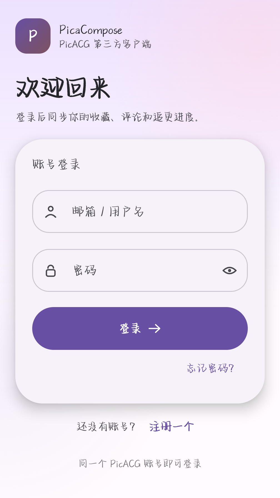

# PicaCompose

[](https://github.com/sanae123123/picacompose/actions/workflows/build.yml)

Compose Multiplatform 跨平台项目 —— 一份 Kotlin 代码，同时跑在 **Android / iOS / Desktop** 上。

## 技术栈

| 组件 | 版本 |
| --- | --- |
| Kotlin | 2.4.10 |
| Compose Multiplatform | 1.11.1 |
| Android Gradle Plugin | 9.1.1 |
| Gradle | 9.6.1 |
| Android SDK | compileSdk 37 / minSdk 24 |
| Ktor | 3.6.1（client，Android=OkHttp / JVM=CIO / iOS=Darwin） |
| kotlinx.serialization | 1.12.0 |

## 目录结构

```
picacompose/
├── picaapi/                     # PicACG API 客户端（纯 KMP，Android/JVM/iOS 通用）
├── shared/                      # 共享模块：UI 与业务逻辑都写在这里
│   ├── src/commonMain/kotlin/com/picacompose/App.kt        # 公共 UI
│   └── src/iosMain/kotlin/com/picacompose/MainViewController.kt
├── androidApp/                  # Android 宿主（MainActivity + Manifest）
├── desktopApp/                  # 桌面宿主（JVM 窗口入口）
├── gradle/libs.versions.toml    # 版本统一管理
└── .github/workflows/build.yml  # CI：推上去自动编译
```

新增界面时，优先改 `shared/src/commonMain`，三个平台会同时生效；只有确实需要平台 API 时才在 `androidMain` / `iosMain` 里写 `expect/actual`。

## 界面

Material You（M3）风格：固定走 M3 基线配色（Compose Multiplatform 里没有 Android 动态取色），
大圆角卡片、渐变背景、胶囊按钮；图标直接取 Google 官方 Material Icons（`material-icons-extended`，
默认 outlined，底部导航选中态换 filled）。



登录成功后进带底部导航的五个页面：**主页**（资料卡 + 快捷入口）、**分类**（`/categories` 真实题材）、
**游戏**（`/games` 站内游戏列表）、**我的**（账号详情、退出登录）、**设置**（会话状态、版本、退出登录）。

勾了「记住账号」就把 token 存在本机（Android 用 SharedPreferences，桌面用 java.util.prefs，
iOS 用 NSUserDefaults），下次打开直接恢复会话进首页；只存 token，不存密码。

## 线路分流

官方客户端的分流不是「多个 API 域名」，而是**域名固定 + 服务端下发 IP 池 + 自定义 DNS**：

- 域名永远 `https://picaapi.picacomic.com/`，它参与签名，改了签名就失效；
- 冷启动先明文 `GET http://68.183.234.72/init`（失败换 `http://206.189.95.169/init`）拿 `addresses[]`；
- 选中「下发 IP」的线路时，把这些 IP 钉进 OkHttp 的 `Dns`，TLS 的 SNI / 证书仍按原域名走。

客户端冷启动第一屏就是线路选择：拉列表、给「系统解析」和「下发 IP」各打一次点，**自动选最快的一条**，
停一秒左右自动进入；想换随时点别的卡片，秒进。上次选过哪条会标「上次」，也记在设置页里。

- Android：`picaapi` 的 `pinnedEngine()` 用 OkHttp 自定义 DNS 实现；`/init` 是明文 HTTP，manifest 开了
  `usesCleartextTraffic`。
- 桌面（CIO）和 iOS（Darwin）引擎没有 DNS 钩子，`pinnedEngine()` 返回 `null`，线路 2/3 会退化成系统解析。

## 本地构建

这台机器上不跑 CI，debug 包直接本机出，改一行代码到装进手机大概 6 秒。关键在三处：

- **Gradle 常驻 + 缓存**：`./gradlew --console=plain --configuration-cache :androidApp:assembleDebug --offline`
  （配置缓存和构建缓存都开着；无改动构建约 1s，改一个文件约 5s，daemon 停了第一次会多 5s 左右）
- **依赖离线**：`GRADLE_USER_HOME=/data/local/tmp/gradle-home`，依赖都在本地，`--offline` 跳过联网检查。
  新加依赖时离线会失败，去掉 `--offline` 联网跑一次即可。
- **关掉安装校验**：`settings put global verifier_verify_adb_installs 0`、
  `settings put global package_verifier_enable 0`，`pm install -r -g` 从 ~15s 掉到 ~0.4s。
  这两项重启后可能被系统改回去，慢了就再设一次。

daemon 常驻会占 ~2G 内存，不用了可以 `./gradlew --stop` 还回去。

## 环境要求

- JDK 17 及以上（项目按 JDK 21 验证）
- Android 端：Android Studio（自带 SDK / JDK）
- 桌面端：任意 JDK 17+，无需 Android SDK
- iOS 端：macOS + Xcode（详见下方说明）

## 运行

```bash
# 桌面版（最快的验证方式）
./gradlew :desktopApp:run

# Android 调试包
./gradlew :androidApp:assembleDebug
# 产物：androidApp/build/outputs/apk/debug/androidApp-debug.apk

# 桌面安装包（dmg / msi / deb）
./gradlew :desktopApp:packageDistributionForCurrentOS
```

也可以直接用 Android Studio 打开仓库根目录，等 Gradle 同步完成后选 `androidApp` 运行。

## iOS

`shared` 已经配好 `iosArm64` 与 `iosSimulatorArm64` 两个 target，框架名为 `Shared`（静态），入口是 `shared/src/iosMain/kotlin/com/picacompose/MainViewController.kt`。

Xcode 工程（`iosApp.xcodeproj`）还没建：生成它需要在 macOS 上跑，没法在 Linux/CI 里可靠地产出。要用 iOS 时，在 macOS 上用 Android Studio 的 Kotlin Multiplatform 插件新建一个 iOS App target，把 `MainViewController` 作为 `UIViewControllerRepresentable` 的根视图，并在 Build Phases 里加上编译 `Shared` 框架的 `embedAndSignAppleFrameworkForXcode` 脚本即可。


## picaapi：PicACG API 客户端

`picaapi/` 是一个纯 Kotlin Multiplatform 的 PicACG 客户端，参考这两个项目重写：

- [czp3009/picacomic-api](https://github.com/czp3009/picacomic-api)（Ktor 1.x，JVM-only）
- [qiunanrima/PicACG-Api-Java](https://github.com/qiunanrima/PicACG-Api-Java)（OkHttp + Gson，JVM-only）
- [shizq123/BIKA](https://github.com/shizq123/BIKA) 的 `core/network`（Ktor 3 + 协程，补全了注册、合集、骑士榜、高级搜索、通知、我的评论等接口）

和它们最大的区别：**全部代码在 `commonMain`**，Android / JVM / iOS 共用一份，
签名算法（HMAC-SHA256）和 SHA-256 也是纯 Kotlin 实现，不依赖任何平台的加密库。

```kotlin
val pica = PicaClient()

pica.auth.signIn("email", "password")            // token 自动保存
val page = pica.comics.list(page = 1, category = "全彩", sort = "dd")
val detail = pica.comics.detail(page.docs.first().id)
val eps = pica.comics.episodes(detail.id)
val pages = pica.comics.pages(detail.id, order = eps.docs.first().order)
val url = pica.imageUrl(pages.pages.docs.first().media)
```

已实现的接口（官方 App 逆向出的 55 个端点了 48 个）：登录 / 注册 / 找回密码 / 重置密码、
初始化 / 分类 / 轮播 / 热搜 / 合集 / 公告 / 版本记录 / pica-apps / 聊天室列表、
漫画列表与检索 / 高级搜索 / 随机推荐 / 排行榜 / 骑士榜 / 详情 / 章节 / 按章节取图 / 相关推荐 /
点赞收藏 / 我的收藏、评论列表 / 楼中楼 / 发评论 / 回复 / 点赞 / 隐藏 / 举报 / 置顶 / 我的评论、
用户资料 / 改签名 / 改密码 / 改 ID / 改密保 / 改头像 / 改头衔 / 签到 / 通知、
游戏列表 / 详情 / 点赞 / 评论（读+写）、utils 下的调经验 / 拉黑 / 删评论。

没做的只有聊天室消息（socket.io，另一套协议）和 `GET init` 的 waka 变体（本域名下要求
`platform` 参数，等同已实现的 `init?platform=android`）。写操作都实现了但没在真机上调，
避免污染账号数据；`auth/forgot-password` 比较特殊——端点确实在，但服务端目前对任何邮箱都
返回 500 `--`，属于服务端自身不可用，客户端实现照官方文档保留。

几个实现细节：

- 签名原文是 `(path + time + nonce + method + apiKey).lowercase()`，`path` 含 query 且不带前导斜杠；
  `PicaSignature.sign()` 里就是这个公式，`CryptoTest` 里有固定测试向量。
- `time` 用本地时钟；客户端会从响应头 `Server-Time` 自动算偏移量并持续校正，所以手机时间不准也能用。
- POST 的 `Content-Type` 必须是 `application/json; charset=UTF-8`（大写）。写成小写 `utf-8`
  或没有 charset，服务端会返回 400/1023 "too many requests"，登录会被误判成限流——这是踩过的坑。
- 响应统一是 `{ code, message, data }` 信封，`PicaClient` 负责解信封，失败抛 `PicaException`。
- 所有 JSON 模型都用 `ignoreUnknownKeys` + 默认值，服务端加字段不会炸。

## 说明

- 版本号集中在 `gradle/libs.versions.toml`，升级只改这一处。
- `shared` 里预置了一个计数器页面，只用来做冒烟验证，业务代码直接替换 `CounterScreen()` 即可。
