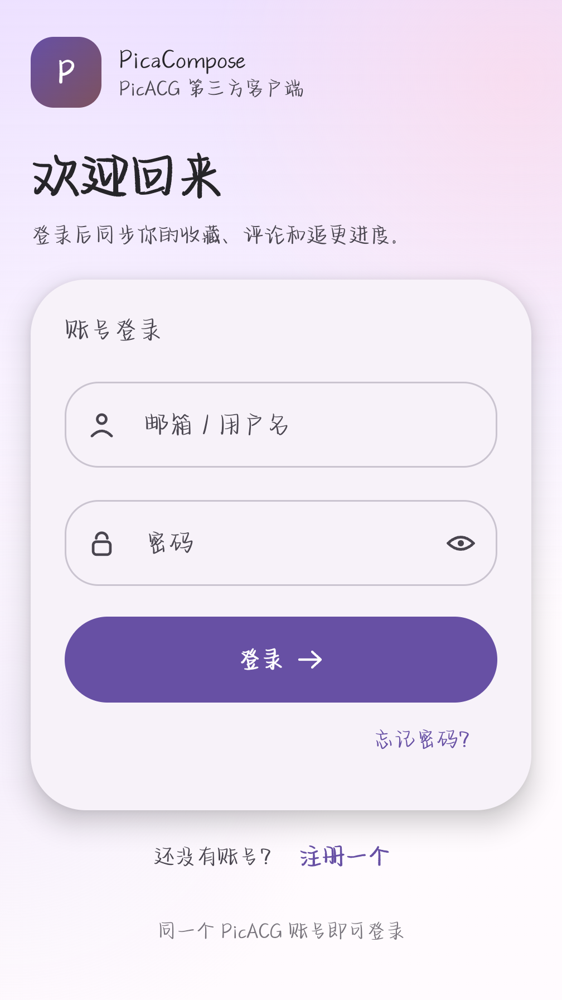

# 🧸 PicaCompose

一本会翻页的 PicACG 小本子
Kotlin 写一遍 · Android / iOS / 桌面一起用

`✿ ・ ｡ ✦ ˚ ✿ ⋆ ✿ ˚ ✦ ｡ ・ ✿`

---

## 🧵 你好呀

PicaCompose 是一个开源的 PicACG 第三方客户端，用 Compose Multiplatform 写的。
登录自己的账号，翻漫画、看评论、逛逛论坛，都还是熟悉的样子，只是做得软一点、暖一点。

  

## 🍬 本子里有什么

- [x] 登录一次，之后都记得你
- [x] 漫画列表、搜索、排行榜、随机推荐
- [x] 在线看漫画，阅读进度记得住
- [x] 评论区、楼中楼、留言板
- [x] 收藏、签到、通知
- [x] 几条线路自动挑最快的那条
- [ ] 聊天室消息（还在路上）

  
   
  ✎ 小猫负责把星星抱好

## 🛍 下载

> [!NOTE]
> 🧺 安装包都放在小篮子里，拿走就好。

Android 安装包在 [Releases](https://github.com/sanae123123/picacompose/releases) 里，
下 `picacompose-*.apk` 侧载就行（Android 7.0 起，minSdk 24）。
发版包和日常调试包可以互相覆盖安装。

  

## 🎨 长这样

  
   
  ✎ 登录页：左边贴 app 图标，右边是账号输入框

进去以后是五个小抽屉：**主页**、**分类**、**游戏**、**我的**、**设置**。

  

## 🧶 想往里看看

- 想自己编译、翻实现细节：看 [技术手账](docs/技术手账.md)
- 想提问题或者许愿：开 [Issue](https://github.com/sanae123123/picacompose/issues)
- 想改点什么：fork 下来提 PR，都欢迎

  

## ✨ 许可

MIT，见 [LICENSE](LICENSE)。用爱发电，不收钱。

`♡ 谢谢看到这里 ♡`

